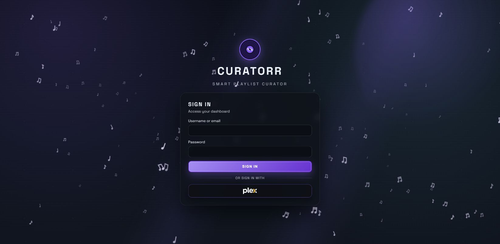

# Authentication and Roles

## Authentication Modes

Curatorr supports two login methods side by side:

### Media server sign-in

Users authenticate with the selected media server.

This supports:

- Plex users
- Plex Home users and managed home-user selection after sign-in
- Jellyfin users
- Emby users

On Plex installs, the Plex server owner is treated as the main admin account when matched against the configured Plex admin user.

Plex Home profiles may require their Home PIN. Select the intended profile after Plex sign-in so listening and playlist state are attached to the correct user.

### Password sign-in for Plex accounts

A Plex user can add a password as a fallback for networks that block Plex sign-in, such as a work VPN. Sign in with Plex, open **User Profile → Password sign-in**, and set a password. On the Curatorr login page you can then use your Plex username or email with that password.

Password sign-in opens the same account as a Plex sign-in: the same playlists, history and role. Role and disabled status are checked again on every sign-in.

- Setting or changing the password needs a Plex sign-in, so someone who only knows the password can't use it to lock you out. You can remove it from either kind of sign-in.
- A local account can't share a username or email with a Plex account that uses password sign-in.
- Password sign-in uses the Plex server token Curatorr saved at your last Plex sign-in. If Plex revokes that token, sign in with Plex once to refresh it.

### Local admin account

Created during setup.

This account exists as an always-available fallback and keeps full admin access even if Plex SSO is unavailable.

## Roles

| Role | Description |
|---|---|
| `Admin` | Full access to settings, jobs, users, themes, logs, and automation. |
| `Co-admin` | Broad access with admin-only actions still restricted. |
| `Power user` | Standard user access plus optional Lidarr automation if enabled by role scope/quota. |
| `User` | Standard per-user history, playlists, discover, and profile access. |
| `Guest` | Read-only style access with restricted interaction. |

## Managing Users

Use `Settings -> Users` to:

- review known users
- change roles
- remove users
- inspect Plex-linked identities and activity context

## Local Admin Preview Mode

The local Curatorr admin can preview the app as another Plex user.

This is useful for:

- checking a user's dashboard, playlists, history, and discover state
- verifying role-based access
- troubleshooting user-specific playback or automation issues

## Lidarr Access by Role

Lidarr access is controlled by:

- whether Lidarr is configured
- whether automation is enabled
- automation scope
- per-role quotas

Users can still be effectively blocked by quota even if the UI surface is visible.

## Music Assistant access

Only an actual Curatorr admin can test, configure, or inspect the Music Assistant integration status. MA user mappings assign plays to existing Curatorr listeners; they do not create a new Curatorr sign-in method or grant those listeners admin access. See [Music Assistant](Music-Assistant.md).
