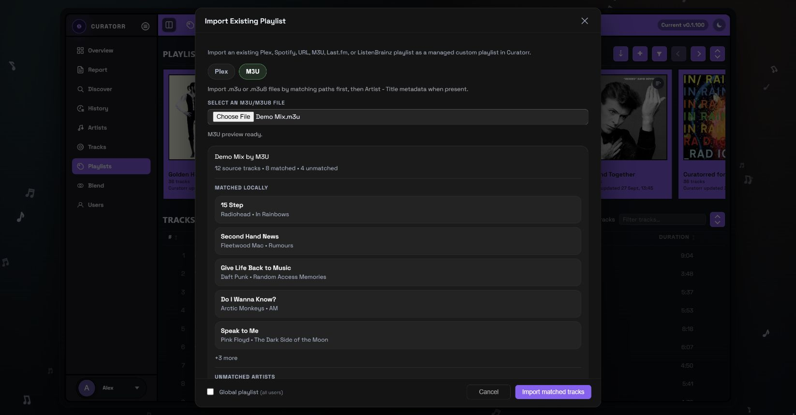

# Playlist Imports

Import existing selections from **Playlists → Import playlist**. Curatorr matches source tracks to your library and creates a managed playlist; importing metadata does not download the audio.

## Sources

| Source | Setup and behavior |
|---|---|
| Plex | Browse existing playlists and music collections on Plex installs |
| Spotify | Connect your account in User Profile; the connected-account tab browses owned playlists |
| TIDAL | Connect your account in User Profile; the TIDAL tab browses playlists owned by that account |
| URL | Preview supported Spotify, public TIDAL, or public YouTube playlist URLs; YouTube requires the container's `YOUTUBE_API_KEY` |
| M3U | Upload an `.m3u` or `.m3u8` file; matches paths first, then available artist/title metadata |
| Watch folder | An admin-configured folder; Curatorr imports and refreshes every `.m3u`/`.m3u8` file in it automatically. See [Watch folder](#watch-folder) |
| Last.fm | Set your username in User Profile, then choose Recommended, Mix, Library, Neighbours, Loved, or a Top Tracks period |
| ListenBrainz | Set your username and optional token in User Profile, then choose Daily Jams, Weekly Jams, or Weekly Exploration |

Tabs and features depend on server type and configuration. Plex has the broadest import/integration support. See [Integrations](Integrations.md) for credentials and platform restrictions.

## Import and review

1. Select a source tab and choose or preview a playlist/file.
2. Review matched and missing counts.
3. Set the new playlist name. Administrators can choose a global playlist where that option is offered.
4. Complete the import and inspect the playlist card and track list.

The **Missing from source** section preserves unmatched entries for review. Select individual tracks or artist groups, then use **Queue for Lidarr review** or **Add to Lidarr queue** when available. Album metadata is retained for acquisition requests when supplied by the source.

## Matching accuracy

Curatorr prefers identifiers or file paths where the source provides them. Metadata matching considers credited artists and title, with duration helping select a match. A named artist must match one of the track's artists; a same-titled song by someone else is left unmatched. Bare M3U entries with no artist information can still use title matching.

From v0.1.99, refreshing an older import can remove wrong-artist matches and increase its missing count. This is expected. Check artist credits and library metadata before requesting missing music.

## Refresh and schedules

Use **Refresh import** from the card menu to re-read/rematch the source. The imported playlist editor offers **Disabled**, **Daily**, **Weekly**, or **Monthly** auto-refresh.

To manage many imports at once:

- **Default for new imports.** An admin can set **Settings → Playlists → Imported Playlists → Default auto-refresh for new imports**. Existing playlists keep their own setting. The watch folder has its own **Auto-refresh for new watch-folder playlists** option, which falls back to this default.
- **Set auto-refresh for a selection.** On the Playlists page, select imported playlists and choose a period from **Auto-refresh…** in the selection bar. Selected playlists that are not imported are left unchanged.
- **Refresh all imported.** The **↻** button in the Playlists header queues every imported playlist for a refresh. They refresh in the background in batches of 25, a few minutes apart.

Scheduled refreshes run with the **Smart Playlist Sync** job, up to 25 imported playlists per user per run, oldest due first. Hundreds of weekly imports are therefore spread across several runs instead of all refreshing at once. A playlist whose refresh fails waits about six hours before it is retried, so a broken source does not hold up the others. Cards show the auto-refresh period for every imported source, including M3U files, watch-folder files and restored backups.

M3U/M3U8 imports support those schedules from v0.1.98. Curatorr stores the uploaded source in its database and rematches that stored content; it does not reread a changed file from your computer. Older imports without stored source content may need a one-time re-import. Newly available tracks return to their source positions once matched.

After adding music, refresh the master track cache before refreshing the import. Source refresh and playlist sync are separate from acquiring missing files through Lidarr.

If an imported Plex playlist or collection no longer exists, for example after a Plex reinstall, **Refresh import** rebuilds from the tracks Curatorr already holds instead of failing. A Plex source is matched by its ID and title, so a different playlist that reuses the ID on a new server is never read. To keep copies of Plex playlists without importing them into Plex again, see [Back up Plex playlists](Playlist-Backup.md#back-up-plex-playlists).

## Watch folder

A watch folder suits playlists generated by another tool. Curatorr checks the folder on a schedule and keeps one imported playlist per file, so nothing has to be uploaded by hand.

### Set it up

1. Mount the folder into the container, for example `./playlists:/app/playlists:ro`. Read-only is fine; Curatorr never writes to it.
2. In **Settings → Playlists → Playlist Watch Folder**, turn on the watch folder and enter the path as the container sees it, for example `/app/playlists`.
3. Choose the user who owns the imported playlists. Turn on **Share as global playlists** to copy them to every user.
4. Save. Curatorr scans straight away, and then on the **Playlist Watch Folder** job schedule (every 15 minutes by default, adjustable under **Settings → Jobs**). Use **Scan now** to check the folder immediately.

### How files are handled

| In the folder | What Curatorr does |
|---|---|
| A new `.m3u` or `.m3u8` file | Imports it as a playlist named after the file, without the extension |
| An edited file | Rematches and updates the same playlist |
| An unchanged file | Skips it |
| A renamed file | Imports a new playlist; the old name is treated as removed |
| An image with the same base name | Uses it as the playlist artwork |
| A removed image | Switches the playlist back to automatic artwork |
| A removed playlist file | Keeps the playlist and marks the file as **Source missing**. Turn on **Delete playlists whose file is removed** to delete the playlist instead |

Artwork can be `.jpg`, `.jpeg`, `.png` or `.webp`, up to 5 MB. For example, `Top 40 Nr. 1 Hits - 1980s.m3u8` uses `Top 40 Nr. 1 Hits - 1980s.jpg`. Subfolders up to four levels deep are scanned, and files and folders whose names start with `.` are ignored. Each playlist file can be up to 2 MB.

If you delete a watch-folder playlist in Curatorr, it stays deleted until its file changes. The **Tracked files** list in the settings card shows each file's status and the last scan result.

Changing the owner affects newly imported files only. Existing playlists stay with their current owner.

### Writing playlists for the watch folder

- Write each playlist under a temporary name, such as `Mix.m3u8.tmp`, and rename it when it is complete. Only `.m3u` and `.m3u8` files are read. Curatorr also waits for a file to be unchanged for a few seconds before reading it.
- Keep filenames stable so that updates refresh the existing playlist.
- Include `#EXTINF` lines with `Artist - Title`. Matching tries file paths first, then filenames, then the `#EXTINF` metadata, which helps when the generator's paths differ from the paths Plex sees.
- Write the artwork before the playlist file, or in the same pass, so the first import picks it up. Artwork added later is applied on the next scan.

**Refresh import** on a watch-folder playlist rereads the file if it is still there, and otherwise rematches the copy Curatorr stored at the last import.

## Convert an import to a smart playlist

Open the imported playlist's **Edit** dialog and choose **Convert to Smart** where offered. Curatorr opens a wizard draft with inferred audio/profile defaults and suggested content filters. Review the suggested chips or switch to all detected genres, moods, and tags, then adjust output rules before saving.

The finishing step can keep the original imported mirror or remove it. Keeping the mirror preserves a separately refreshable source playlist; the smart playlist instead follows the rules you save. Conversion is useful when you want the source's musical character to guide a playlist that can evolve beyond its original track list.

## Spotify URL previews

Owned playlists imported from the connected **Spotify** tab are the most reliable route for large playlists. The **URL** tab depends on Spotify's public page data and can expose only part of a shared/public playlist. If the preview is incomplete, copy the tracks into a playlist you own in Spotify and import that copy through the connected-account tab.

## TIDAL imports

The **TIDAL** tab lists playlists owned by the connected TIDAL account, including private ones. Public TIDAL playlist links (`https://tidal.com/playlist/...`) can be pasted into the **URL** tab by any user, whether or not they have connected TIDAL. A private playlist owned by another account can't be read; import it from the owner's Curatorr account instead.

Only tracks are imported. Videos in a TIDAL playlist are skipped and do not count as missing. TIDAL import requires `TIDAL_CLIENT_ID` and `TIDAL_CLIENT_SECRET` on the container; see [Integrations](Integrations.md#tidal).

See [Smart Playlists](Smart-Playlists.md) for artwork, filters, and general playlist management.
